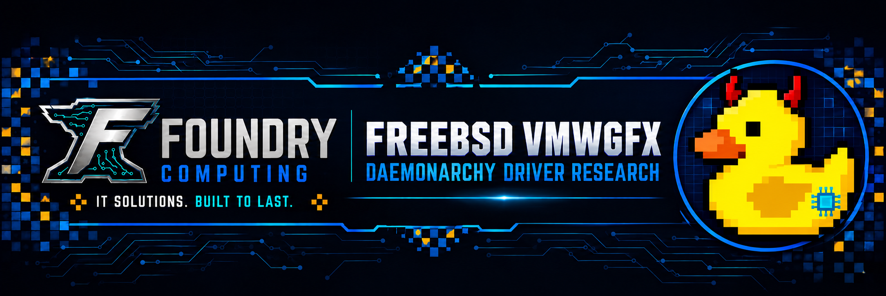

<!-- foundry-brand:start -->

A project by [Foundry Computing](https://github.com/Foundry-Computing) · **IT solutions. Built to last.**

Meet **Kernel**, the driver-research duck with red pixel horns and a cyan chip.
<!-- foundry-brand:end -->

# FreeBSD vmwgfx for Daemonarchy

A Foundry Computing research project to restore a native VMware graphics path for Daemonarchy's Hyprland desktop on FreeBSD.

**November 6, 2026 — Native Hyprland is working in Foundry Computing's Daemonarchy VMware guest.** After a full VM reboot, the owner signed in through SDDM. The packaged Wayland session loaded the expected Daemonarchy wallpaper, workspace bar, and welcome notifications. We confirmed the desktop in the VMware console.

## How we got there

The FreeBSD port went from 32 of 38 source files compiling, to 36, to all 38 and a linked `vmwgfx.ko` (version 2.20.0). A late startup service loads the module after the DRM core is ready. We tested that sequence in an isolated clone before deploying it to the working guest.

The sign-in screen and the desktop shell needed their own fixes. SDDM displays the greeter through VMware graphics on the tested kernel, and the packaged session uses Qt Quick software rendering for the Quickshell theme. Hyprland runs as the native Wayland compositor on the VMware DRM/KMS path.

| Check | Result |
| --- | --- |
| Driver and display | VMware SVGA II attached, the DRM display and render devices appeared, and the VMware console showed the greeter. |
| Graphics buffers and rendering | Shared buffer aliasing and Mesa SVGA3D EGL clear and readback passed after reboot. |
| Native Hyprland | The isolated clone and the working guest ran native Hyprland. The working guest displayed a Wayland terminal during the test session. |
| Normal desktop sign-in | After a full reboot, SDDM launched the packaged Wayland session and the expected theme loaded. |

The original FreeBSD kernel and the X11/Openbox compatibility session are available for recovery.

## Pinned source checkpoint

| Component | Revision |
| --- | --- |
| Daemonarchy kernel source | jordanhubbard/daemonarchy-src `303b3646270ffa4bf7cec65c5c1d28bd8000cbce`, OSVERSION 1600029 |
| FreeBSD DRM baseline | freebsd/drm-kmod `1d054ae55685c45c23aa86541427dfc72afa9ca1`, tag drm_v6.12.110_1 |
| Daemonarchy ports patches | jordanhubbard/daemonarchy-ports `dd277aff0961905b32a122fa4909051d7a62abb1` |
| Linux vmwgfx source | gregkh/linux `fa5b06866b643cce7072a4e7c6be7ee3f0f1b95c`, tag v6.12.110 |

## What the result covers

These results apply to Foundry Computing's VMware SVGA II guest and the pinned FreeBSD and DRM stack listed above. The imported-buffer work covers the standard DRM GEM exporter. Other DMA-BUF exporters, suspend and resume, and other GPU hardware are outside the verified coverage.

## Follow the work and help

This repository is the public progress log. It contains milestone notes, source references, and upstream credits.

Follow or star the repository for updates. Issues are welcome for relevant upstream work, native-interface design suggestions and corrections to the documented findings. Include source revisions and a small reproducible example where possible. Keep credentials, private addresses and customer information out of reports.

We especially welcome experience with FreeBSD VM/pager internals, LinuxKPI, DRM/GEM, DMA-BUF, VMware transport and kernel testing. Please propose a bounded design or review topic before attempting runtime experiments.

## Upstream context and credit

This work builds on the Linux vmwgfx driver, FreeBSD DRM/LinuxKPI, Daemonarchy and Hyprland/Aquamarine. Historical FreeBSD vmwgfx support existed; we are not claiming to be the first VMware graphics effort on FreeBSD.

- [FreeBSD request to restore VMware and other virtual GPU drivers](https://github.com/freebsd/drm-kmod/issues/356)
- [FreeBSD DRM sources](https://github.com/freebsd/drm-kmod)
- [Linux vmwgfx source](https://github.com/gregkh/linux/tree/v6.12.110/drivers/gpu/drm/vmwgfx)
- [Daemonarchy](https://github.com/jordanhubbard/daemonarchy)
- [Aquamarine](https://github.com/hyprwm/aquamarine)

Foundry Computing's contribution at this checkpoint is the documented, pinned porting experiment and its initial adaptations and tests. This project is not an official release or endorsement by the upstream projects.

## From the workshop

Howdy! Mr. Fix I.T. here. A desktop that lights up is encouraging. A driver that earns our trust takes a little more work. Pull up a chair, follow the evidence, and help us make the next checkmark mean something.

Read the workshop stories and VM series at [The Foundry Log](https://foundrylog.blogspot.com/).
